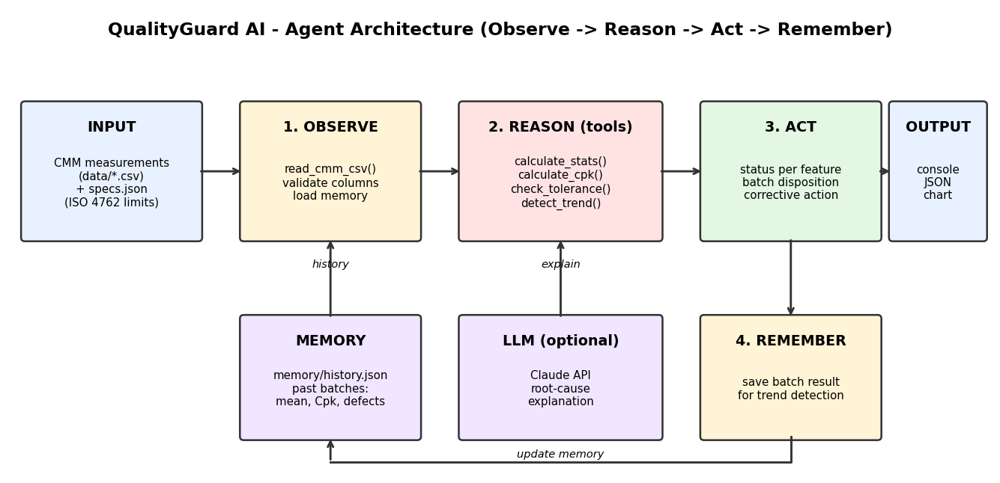
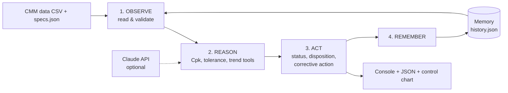

# QualityGuard AI - Agentic Quality-Control Agent for Fasteners

**Agent type:** Agentic Agent (autonomous inspection, reasoning and decision-making)
**Component:** M8 x 30 mm Socket Head Cap Screw, Grade 12.9 (ISO 4762)
**Author:** Kallu Deepika - B.Tech Mechanical Engineering, VIT Vellore

## Problem statement
Manual inspection of fastener batches is slow, and process drift (e.g. a wearing heading die)
is usually noticed only after defective parts are produced. QualityGuard AI reads CMM
measurements, decides whether a batch can be released, explains why, and learns from past
batches to warn about drift **before** parts go out of tolerance.

## Schema (architecture)




## Why it is "agentic"
| Capability | Where |
|---|---|
| Perceives its environment | reads CMM CSV files and validates them |
| Uses tools | `read_cmm_csv`, `calculate_stats`, `calculate_cpk`, `check_tolerance`, `detect_trend`, `llm_explain` |
| Reasons and decides autonomously | per-feature status (PASS / WATCH / WARNING / CRITICAL) and batch disposition |
| Has memory | `memory/history.json` stores earlier batches, enabling drift detection |
| Acts | writes a JSON audit report and a control chart, recommends corrective action |
| Optional LLM | with `ANTHROPIC_API_KEY` set, Claude adds a root-cause explanation |

## Project structure
```
qualityguard_agent.py   main agent (tools, memory, agent loop, CLI)
specs.json              ISO 4762 / ISO 965-1 tolerance limits
data/                   4 sample CMM batches (20 parts each)
tests/test_agent.py     unit tests
docs/                   schema diagram, sample output and chart
memory/ reports/        generated at run time
```

## Run
```bash
pip install -r requirements.txt
python qualityguard_agent.py data/batch_001_SCREW-8830.csv
python qualityguard_agent.py data/batch_002_SCREW-8831.csv
python qualityguard_agent.py data/batch_003_SCREW-8832.csv   # drift warning
python qualityguard_agent.py data/batch_004_SCREW-8833.csv   # batch rejected
```
Add `--no-llm` to skip the optional Claude analysis, or `--reset-memory` to start fresh.
Run the tests with `python -m unittest discover -s tests -v`.

## Demo story (the four sample batches)
| Batch | Head-diameter mean | Agent decision |
|---|---|---|
| 001 | ~12.84 mm | Release with monitoring |
| 002 | ~12.88 mm | Release |
| 003 | ~12.93 mm | **Pending review**: upward drift toward USL detected from memory, before any part is out of tolerance |
| 004 | ~12.99 mm | **Rejected**: most heads exceed the 13.00 mm limit |

See `docs/sample_output.txt` and `docs/sample_chart.png`.

## Decision rules
1. Defect rate > 5% -> CRITICAL (reject / quarantine)
2. Any defect <= 5% -> WARNING (100% sorting)
3. Cpk < 1.00 -> WARNING (process not capable)
4. Mean drifting toward a limit over 3 batches -> WARNING (trend)
5. Cpk < 1.33 -> WATCH (marginal)
6. Otherwise -> PASS

Batch disposition follows the worst feature status.

## Standards and limits
ISO 4762 (head diameter 12.73-13.00 mm), ISO 965-1 (M8x1.25, 6g pitch diameter 7.042-7.160 mm).
The sample data is simulated. The screw-length limits are an assumed +/-0.25 mm design tolerance, so
check them against your standard table.

## Future scope
Live CMM / IoT integration, SPC rules (Western Electric), dashboard UI, more fastener sizes.
